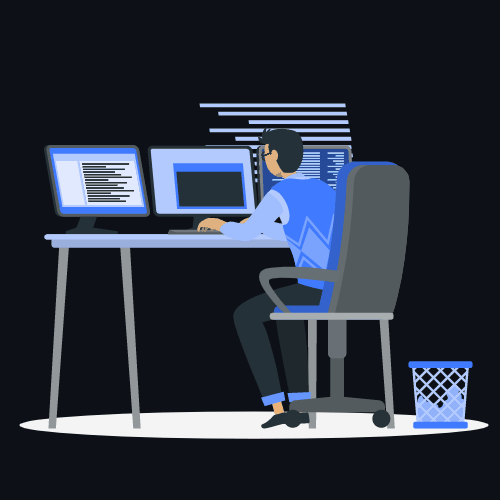
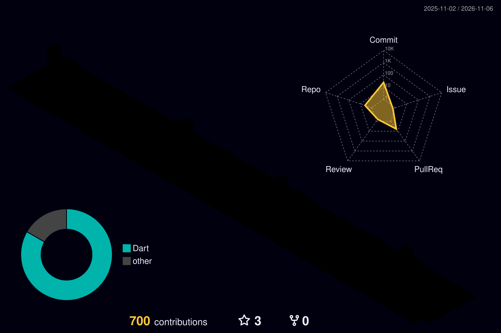

<h1 align="center">Hi 👋, I'm Rohan Irshad</h1>
<h3 align="center">Senior Mobile Application Engineer | Flutter & Dart Specialist</h3>

  
  
  

# 💫 About Me:
Senior Mobile Application Engineer specializing in **Flutter & Dart**, with **3+ years of commercial experience** architecting, engineering, and launching production mobile applications across the Google Play Store and Apple App Store.

- 🚀 **Proven Track Record:** Architected & shipped **30+ commercial mobile apps** serving **10,000+ active users** worldwide.
- 🏗️ **Clean Architecture & Scalability:** Strict separation of concerns, SOLID principles, and modular design using **Riverpod**, **BLoC**, **Provider**, and **GetX**.
- ⚡ **Native Platform Bridges:** Custom platform channels connecting native **iOS (Swift/Objective-C)** and **Android (Kotlin/Java)** capabilities, background tasks, and proprietary SDKs.
- 💳 **Monetization & In-App Purchases:** End-to-end subscription architectures using **RevenueCat**, **StoreKit**, **Google Play Billing**, and AdMob mediation.
- 🤖 **AI-Powered Mobile Systems:** Building intelligent, context-aware mobile experiences with **Google Gemini API**, **LangChain**, and agentic workflows.
- 🎓 **Certified Specialist:** Authorized credentials from **Google Cloud** & **IBM** in Flutter Architecture and AI Agent Development.

📍 **Based in:** Lahore, Pakistan 🇵🇰 &nbsp;|&nbsp; 🌐 **Official Website:** [rohanirshad.dev](https://rohanirshad.dev) &nbsp;|&nbsp; 💼 **Open to:** Senior Mobile Roles & High-Impact Contracts

# 🛠️ Technical Stack:

### 📱 Mobile & Cross-Platform

### ⚡ State Management & Architecture

### 🔥 Backend, Cloud & APIs

### 🤖 Generative AI & Monetization

# 📊 GitHub Activity & Stats:

  
  

  

### 🏆 3D Contribution Graph

  

### ✍️ Daily Dev Inspiration

  

## 🤝 Let's Connect:

  
  
  

